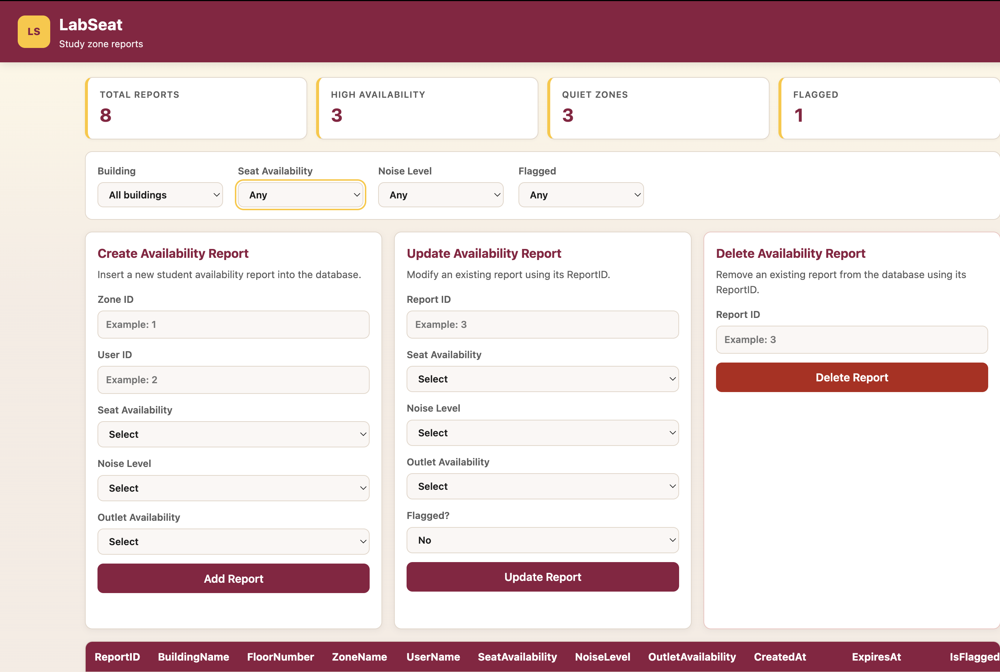
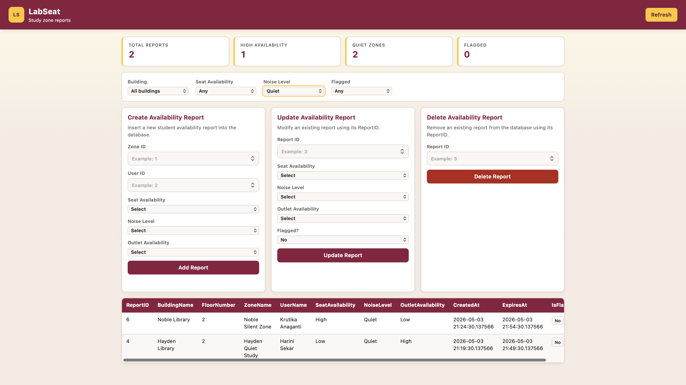
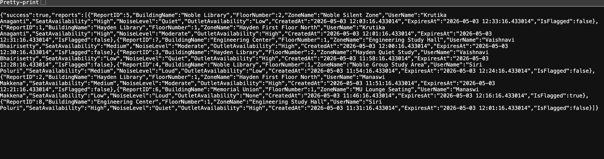
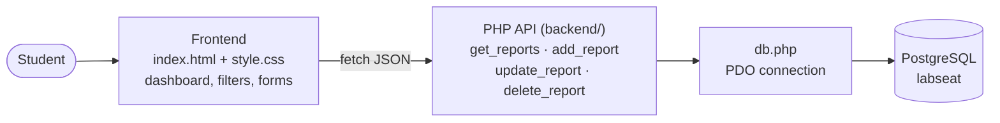
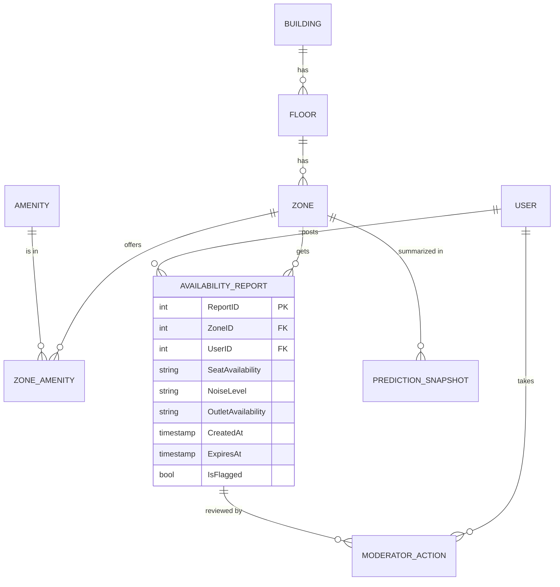

# LabSeat: Live Study Space Finder

A web app that helps ASU students find open study spaces on the Tempe campus. Students post quick availability reports for study zones (how many seats are free, how loud it is, whether outlets are open), and everyone else can see and filter them in one place.

Built for CSE 412 (Database Management), Phase 03.



## The Problem

During midterms and finals, ASU students walk from Hayden to Noble to the Engineering Center just to find every seat taken. There is no easy way to know which study zones are free, quiet or have open outlets before you get there. LabSeat lets students share that in a few seconds, so everyone else can check before they walk over.

## Features

- Live dashboard with totals for reports, high availability zones, quiet zones and flagged reports
- Filter reports by building, seat availability, noise level and flagged status
- Create, update and delete availability reports straight from the page
- PHP JSON API backed by a normalized PostgreSQL schema (buildings, floors, zones, amenities, users, reports)

| Filtering by noise level | JSON from the read endpoint |
|---|---|
|  |  |

## Tech Stack

| Layer    | Technology                  |
|----------|-----------------------------|
| Frontend | HTML, CSS, JavaScript       |
| Backend  | PHP (PDO)                   |
| Database | PostgreSQL                  |

## Architecture

The browser talks to a small set of PHP endpoints that return JSON. Each endpoint opens one shared PDO connection to PostgreSQL.



**How a page load works**

1. `index.html` calls `get_reports.php`.
2. The endpoint joins reports with their zone, floor, building and user, and returns only reports that have not expired.
3. The page fills the summary cards, the filter dropdowns and the table from that one response. Changing a filter just re-filters the data already in the browser.
4. Creating, updating or deleting a report sends JSON to the matching endpoint, then reloads the list.

### Database



## Project Layout

```
frontend/   index.html and style.css (dashboard, filters, CRUD forms)
backend/    PHP API: get_reports, add_report, update_report, delete_report
database/   Schema, seed data and reference queries
docs/       Screenshots
```

## My Role

I built the main frontend (`frontend/index.html` and `style.css`):

- Page layout and the summary cards for total reports, high availability, quiet zones and flagged reports
- Filters for building, seat availability, noise level and flagged status, with dropdown options built from the live data
- The reports table, plus loading and error states so the page never just goes blank when the API fails

## Key Decisions

- **Reports expire after 30 minutes.** Seat availability changes fast, so each report gets an `ExpiresAt` time and the API shows only active reports. If nothing is active, it falls back to the latest reports so the page is never empty.
- **Safe database queries.** Every write uses PDO prepared statements, and IDs are checked with `filter_var` before they reach the database. This blocks SQL injection.
- **The database enforces the rules.** `CHECK` constraints limit seat, noise and outlet values to a fixed set, so bad data gets rejected even if a request skips the frontend.
- **Clear errors from the API.** Endpoints return the right status codes (400 for bad input, 404 for a missing report, 405 for the wrong method). Deleting a report that a moderator action still points to returns 409 with a message explaining why.
- **Filtering happens in the browser.** The page loads reports once and filters them instantly as you change dropdowns, with no extra API calls.
- **The schema is normalized.** Buildings, floors, zones and amenities have separate tables, so a building name is stored once and new campuses or floors can be added without changing the code.

## Run It Locally

You need PHP 8 (with the `pdo_pgsql` extension) and PostgreSQL.

1. Create the database and load the schema and sample data:

   ```bash
   createdb labseat
   psql -d labseat -f database/Phase2.sql
   psql -d labseat -f database/labseat_seed_data.sql
   ```

2. Add your database login:

   ```bash
   cp backend/config.example.php backend/config.php
   ```

   Then open `backend/config.php` and fill in `DB_USER` and `DB_PASS`. This file is ignored by Git, so your password stays on your machine.

3. Start PHP from the repo root:

   ```bash
   php -S localhost:8000
   ```

4. Open [http://localhost:8000/frontend/](http://localhost:8000/frontend/) in your browser. You can also check the API directly at [http://localhost:8000/backend/get_reports.php](http://localhost:8000/backend/get_reports.php).

## API Endpoints

| Method | Endpoint                     | What it does              |
|--------|------------------------------|---------------------------|
| GET    | `backend/get_reports.php`    | List all reports with building, floor, zone and user details |
| POST   | `backend/add_report.php`     | Add a new report          |
| PUT, PATCH or POST | `backend/update_report.php`  | Update an existing report |
| DELETE or POST | `backend/delete_report.php`  | Delete a report by ID     |

## Team

| Person | Responsibility |
|--------|---------------|
| Manaswi Makkena | Frontend: index.html, dashboard and live availability display |
| Siri Poluri | Frontend: CRUD forms, styling and JavaScript actions |
| Krutika Anaganti | Backend: database connection and read endpoint |
| Vaishnavi Bhairishetty | Backend: create, update and delete endpoints |
